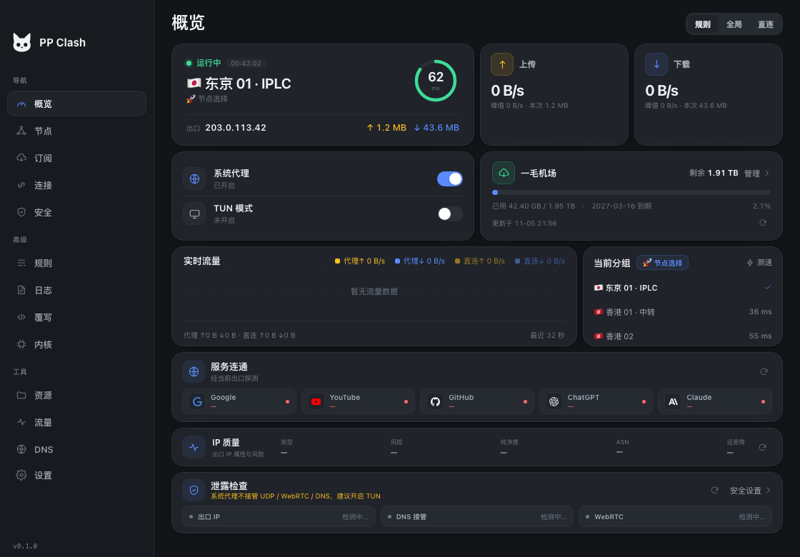
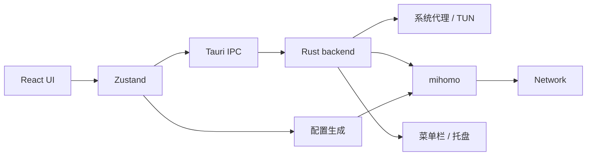

<div align="center">


# PP Clash

**把防泄漏做成默认行为的 Clash 客户端**

原生质感 · 开箱即用 · macOS / Windows

[](LICENSE)


[功能](#功能) · [截图](#截图) · [开发](#开发) · [构建](#构建) · [安全](#安全说明) · [许可证](#许可证)

</div>

---

PP Clash 是一个基于 **Tauri 2 + Rust + React + mihomo** 的跨平台 Clash 客户端。它不要求用户先学一遍 DNS 和 TUN，而是把最常见的泄漏点做成默认行为，同时保留 Clash 的高级能力。

## 功能

| 连接 | 节点 | 订阅 |
|---|---|---|
| TUN / 系统代理 | 分组、测速、固定 | 多订阅、排序、配额 |
| 状态恢复 | 自动故障切换 | 更新间隔、代理更新 |
| 出口 IP / DNS / WebRTC 检测 | 节点延迟与 IP 质量 | 本地文件导入 |

| 进阶 | 观测 |
|---|---|
| 规则可视化编辑 | 实时流量与连接 |
| 自定义规则 | 日志导出 |
| YAML / JS 覆写沙箱 | 脱敏诊断包 |
| 内核版本与资源管理 | 应用更新检查 |

### 设计原则

- **防泄漏默认开启**：DNS 接管、WebRTC、IPv6、TUN 严格路由不需要逐项手写
- **信息密集但不拥挤**：固定列宽、统一字号、避免数值变化导致布局跳动
- **本地优先**：不收集遥测；订阅、配置、日志只留在本机
- **原生体验**：macOS 菜单栏面板 / Windows 系统托盘，跟随系统明暗主题

## 截图



> 截图使用演示数据，不包含真实节点或订阅信息。

## 快速开始

### 环境

- Node.js 20+
- Rust 1.77+
- macOS：Command Line Tools
- Windows：Visual Studio Build Tools + WebView2

```bash
git clone https://github.com/JasperPengC/PPClash.git
cd PPClash
npm install
```

首次构建前生成内核资源包（约 40MB，仓库不提交二进制）：

```bash
./scripts/prepare-resources.sh
```

脚本会从本机 mihomo 和 Geo 数据打包；也可以从 [mihomo Releases](https://github.com/MetaCubeX/mihomo/releases) 与 [meta-rules-dat](https://github.com/MetaCubeX/meta-rules-dat/releases) 自行准备。

### 运行

```bash
npm run app
```

## 构建

### macOS

```bash
./scripts/bundle.sh                  # 当前架构 .app
UNIVERSAL=1 ./scripts/bundle.sh     # Universal .app
./scripts/build-dmg.sh              # DMG
```

当前使用 **ad-hoc 签名**，没有 Apple 公证。首次打开如被 Gatekeeper 拦截：

```bash
xattr -dr com.apple.quarantine "/Applications/PP Clash.app"
```

### Windows

```bash
npm run tauri build
```

NSIS 安装包输出到 `src-tauri/target/release/bundle/nsis/`。

## 架构



- 前端负责界面、状态与配置生成
- Rust 负责进程生命周期、提权、系统代理、托盘与本机诊断
- mihomo 负责实际网络转发与规则匹配

## 安全说明

- 控制端口默认只监听 `127.0.0.1`，使用随机 controller secret
- TUN 首次启用需要管理员授权
- 开启局域网访问必须同时配置认证
- 应用更新只走 GitHub Releases，并校验 SHA-256
- 诊断包会脱敏订阅 URL、正文、认证信息和 controller secret
- 不收集遥测，不上传运行时数据

## 目录

```text
src/            React UI
src-tauri/      Rust / Tauri
scripts/        构建与打包脚本
test/           前端单元测试
```

## 参与贡献

欢迎提交 Issue 和 Pull Request。修改前请先确认：

- `npm run build`、`npx vitest run` 通过
- 涉及配置生成的改动需要跑 mihomo 配置校验
- 不提交 `kernel.zip`、日志、订阅、证书或本地状态

## 许可证

本项目以 **GNU Affero General Public License v3.0 only（AGPL-3.0-only）** 发布。

分发修改版，或通过网络向用户提供修改版功能时，请遵守 AGPL-3.0 第 13 条，向用户提供对应完整源码。

第三方组件与许可证见 [THIRD_PARTY_NOTICES.md](THIRD_PARTY_NOTICES.md)。
