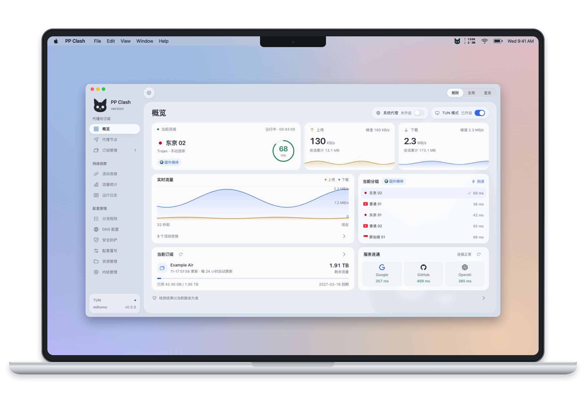

  <picture>
    <source media="(prefers-color-scheme: dark)" srcset="assets/readme/logo-dark.svg">
    
  </picture>

<h1 align="center">PP Clash</h1>

<strong>为桌面与 Android 打造的 mihomo 客户端，连接状态一目了然。</strong>

<a href="README.md">English</a> · <a href="README.zh-CN.md">简体中文</a>

  
  
  
  
  

> **重要：PP Clash 不提供代理节点或订阅服务。** 请自行准备订阅或配置文件。

<a href="#功能">功能</a> · <a href="#android">Android</a> · <a href="#下载安装">下载安装</a> · <a href="#安全防护">安全防护</a>

  <picture>
    <source media="(prefers-color-scheme: dark)" srcset="assets/readme/showcase-dark.webp">
    
  </picture>

桌面与 Android 同屏展示 · 真实应用界面，使用演示数据。

## 功能

- **订阅与节点。** 导入订阅或本地配置，比较节点延迟，查看用量与到期时间。再次打开应用时，会记住上次选择的节点。
- **连接看得见。** 当前节点、实时流量、活动连接、分流规则、DNS 和运行日志，都能随时查看。
- **分流由你决定。** 支持规则、全局和直连模式；桌面端使用系统代理与 TUN，Android 通过一个开关控制 VPN 连接。
- **常用操作，随手可达。** 桌面端有菜单栏快捷面板，Android 有悬浮导航与触控布局。两端均支持浅色、深色和跟随系统主题。
- **桌面端的进阶工具。** 管理 mihomo 内核版本、编辑 YAML 或 JavaScript 覆写，以及备份和恢复应用数据。

## Android

为手机重新安排操作：看一眼当前节点，点延迟圆环测速，用大按钮连接。实时流量始终可见，订阅的更新、编辑和切换也都放在顺手的位置。分流数据库随应用内置，首次导入订阅无需额外下载。

**支持 Android 7.0 及以上的 64 位设备。** ARM64 已在 Android 13 手机上验证；x86_64 已完成构建，尚未进行实机验证。

## 下载安装

从[最新 Release](https://github.com/JasperPengC/pp-clash/releases/latest) 下载，根据操作系统和处理器架构选择安装包：

| 平台 | 安装包 |
| :--- | :--- |
| macOS · Intel | DMG · x86_64 |
| macOS · Apple 芯片 | DMG · aarch64（ARM64） |
| Windows · x64 | 安装程序 · amd64 |
| Windows · ARM64 | 安装程序 · ARM64 |
| Linux · x64 / ARM64 | `.deb`、`.rpm` 或 `.AppImage` |
| Android · ARM64 / x86_64 | APK · arm64-v8a / x86_64 |

目前已完成 macOS Intel 和 Windows x64 实机测试；Apple 芯片、Windows ARM64 和 Linux 构建仍待实机验证。

Linux 需要 WebKitGTK 4.1 和 Ayatana AppIndicator。AppImage 仍使用系统提供的 GTK 和 WebKitGTK 库。

macOS 首次打开

当前 macOS 安装包使用本地签名，尚未完成 Apple 公证。如果系统阻止打开，请在“系统设置 → 隐私与安全性”中找到 PP Clash，选择**仍要打开**。

首次使用时，导入自己的订阅或本地配置并选择节点。桌面端按需开启系统代理或 TUN；Android 点击连接按钮，并允许系统 VPN 授权。

## 安全防护

DNS 与 WebRTC 防护已纳入默认配置：启用加密 DNS、按规则解析和 Fake-IP，并关闭 IPv6。规则模式下还会加入 STUN 阻断规则。桌面端安全页面可以检查当前运行中的 DNS 与 STUN 设置，并在应用内检测 WebRTC 候选。

桌面端系统代理不接管 UDP，WebRTC 等协议使用的 UDP 流量需要通过 TUN 接管；Android 使用系统 VPN 服务。这些防护取决于实际生效的配置和流量接管情况，不代表所有浏览器、应用或网络路径都不会泄漏。

## 关于

代理核心使用 [mihomo](https://github.com/MetaCubeX/mihomo)，应用基于 Tauri、Rust、React 和 TypeScript 构建。

项目采用 [AGPL-3.0-only](LICENSE) 许可证。第三方组件许可信息见 [THIRD_PARTY_NOTICES.md](THIRD_PARTY_NOTICES.md)。
